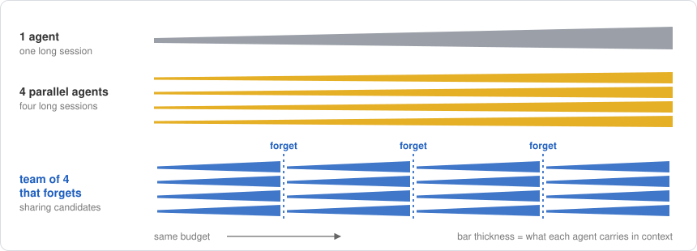

<h1 align="center">lethe</h1>

<p align="center">
  <a href="https://github.com/tatra-labs/lethe/actions/workflows/tests.yml"></a>
  <a href="https://arxiv.org/abs/2610.20563"></a>
  <a href="LICENSE"></a>
</p>

<p align="center"><b>Agent teams that forget.</b><br>
Every so often, wipe every agent's memory, restart the whole team from the best candidate, and watch a plateaued search climb again.</p>

<p align="center">
  <a href="https://arxiv.org/abs/2610.20563">Paper</a> ·
  <a href="#quickstart">Quickstart</a> ·
  <a href="#how-it-works">How it works</a> ·
  <a href="#tasks">Tasks</a> ·
  <a href="#bring-your-own-task">Your own task</a>
</p>



LLM agents that improve a program over many iterations (AlphaEvolve, autoresearch and the like) hit
the same wall. The longer an agent runs, the more it is anchored to its own past attempts: its
edits shrink, its reasoning shrinks, and the score flattens. This happens whether you run one agent
longer, run several in parallel, or let them build on each other's work.

[*Scaling Discovery Requires Forgetting*](https://arxiv.org/abs/2610.20563) (Tan et al., UC Berkeley,
October 2026) shows that the fix is almost embarrassingly simple: **forget**. Periodically discard
every agent's session and every past candidate, keep only the best candidate, and start a fresh
team from it. At the same budget:

| | AHC014 score ↑ | VLIW kernel cycles ↓ | Frontier-CS Q171 ↑ | nanochat val BPB ↓ |
|---|---:|---:|---:|---:|
| 1 agent | 795k ± 210k | 1,426 ± 197 | 64.0 ± 6.2 | 0.980 |
| 4 parallel agents | 964k ± 57k | 1,220 ± 44 | 70.2 ± 1.1 | 0.980 |
| **team of 4 that forgets** | **1,103k ± 50k** | **1,097 ± 18** | **80.8 ± 2.9** | **0.961** |

<sub>Mean ± s.d. over 3 runs with DeepSeek V4.1 Flash agents, from Table 1 of the paper.</sub>

**lethe** is an independent, dependency-free implementation of that harness in under 1,000 lines
of Python. The agents can be any OpenAI-compatible model (hosted or local) or Claude Code.

## Why forgetting works

The paper traces the plateau to the agents themselves, not to the problem:

- **Sessions narrow.** Before its first forget, a team's edits fall from about 150 changed lines to
  30, and its reasoning from about 28k tokens per proposal to 7k. Right after a forget, edits jump
  back to about 50 lines and reasoning doubles.
- **Agents talk themselves out of trying.** On the VLIW kernel, one single agent stopped at 1,710
  cycles, writing *"I've reached the practical limit of this machine configuration."* Of its 763
  turns, 532 produced no candidate at all. The team that forgets reached 1,077 cycles on the same
  machine.
- **Little is lost.** The best candidate already contains most of what earlier sessions learned;
  what gets discarded is mostly the record of how it was found, including every failed direction
  the agent was anchored to. 32 of the paper's 36 forgets led to a new best within the next round.
- **It is also cheaper.** From the same plateaued state, continuing a team for 30 more proposals
  per agent gained 1.4% for $24.67; forgetting gained 9.2% for $15.32, because fresh sessions are
  short.

## What you need

Forgetting unblocks agents that make progress and then stall; it cannot help an agent that never
improves on the starting candidate. In our tests a 4-bit Qwen3.5-9B on a laptop GPU did not beat a
single starting candidate in about 120 proposals across these tasks, with or without thinking, so
every strategy stayed flat. Use a model at least as capable as the paper's DeepSeek V4.1 Flash,
through any OpenAI-compatible API or through Claude Code.

## Quickstart

```bash
git clone https://github.com/tatra-labs/lethe && cd lethe
pip install -e ".[plot,tasks]"
```

**With Claude Code** as the agents (uses your existing `claude` login):

```bash
lethe run tasks/bin_packing --agent claude -m haiku --budget 48
```

**With any OpenAI-compatible API** (OpenAI, OpenRouter, DeepSeek, Together, vLLM, ...):

```bash
export OPENAI_API_KEY=...
lethe run tasks/bin_packing -m <model> --base-url https://openrouter.ai/api/v1 --budget 64
```

**Fully local**, with any server that speaks the same API ([llama.cpp](https://github.com/ggml-org/llama.cpp),
vLLM, Ollama, LM Studio), as long as the model is strong enough (see above). Give the server one slot
per agent:

```bash
llama-server -m <model>.gguf -ngl 99 -c 131072 -np 4 --jinja
lethe run tasks/bin_packing -m local --budget 64
```

Every run streams one line per proposal and writes a run directory:

```
runs/bin_packing-forget-20261022-093000/
  events.jsonl     one line per proposal: score, best so far, lines changed, tokens, cost
  best/            the best candidate so far, updated live
  round0/ ...      each round's repository and agent worktrees, kept for inspection
  summary.json
```

**Compare strategies** on the same budget and plot them:

```bash
lethe compare tasks/bin_packing --budget 96 -m <model>   # 1 agent, 4 parallel agents, team that forgets
lethe plot runs/my-run-a runs/my-run-b --edits -o chart.png
```

`compare` writes `compare.png`: the best score against proposals spent, with every forget marked,
next to the median size of each edit at each step of a session, the paper's sign of anchoring.
Every agent reply is kept under `replies/` in the run directory.

## How it works

lethe follows the harness of the paper (Figure 3 there):

1. **The search state lives in git.** Every proposal is a commit. Each agent works in its own
   worktree of the round's repository, so it can `git show` or `git diff` any candidate, including
   its peers'.
2. **A reducer prepares each turn.** Before every proposal it writes `.context/` into the agent's
   workspace: the judge's feedback on the current candidate, the agent's own attempts this
   session, and for a team, each peer's attempts and best candidate (as a diff against yours).
3. **The agent edits; the harness judges.** The harness commits the workspace, scores it with the
   task's judge, and keeps it if it beats the agent's current candidate. Otherwise the workspace
   is reset and the agent is told why.
4. **Forgetting splits the budget into rounds.** At each forget, every session is dropped and the
   next round starts in a brand-new repository seeded only with the best candidate across the
   team. There is no history left to read: every agent starts from that one candidate with an
   empty context and the same first message as round one.

| strategy | agents | share candidates | rounds | |
|---|:-:|:-:|:-:|---|
| `single` | 1 | | 1 | one session for the whole budget |
| `parallel` | 4 | | 1 | the budget split four ways |
| `team` | 4 | ✓ | 1 | communication, no forgetting |
| `forget` (default) | 4 | ✓ | 4 | the paper's method: three forgets |

`--agents`, `--rounds` and `--team/--no-team` override any preset; for example
`-s single --rounds 4` is a single agent that forgets.

**Agents.** `--agent llm` drives any `/chat/completions` endpoint. It sees the workspace and
`.context/` pasted into each message and replies with SEARCH/REPLACE edit blocks; its session is
the chat history, trimmed from the oldest exchanges to `--max-context`. `--agent claude` runs the
Claude Code CLI headless with file tools and read-only git, continues its session with `--resume`,
and starts a new one when it forgets. In our tests that cost $0.05–0.09 per proposal with Haiku.
Any object with `turn(message, workspace)` and `forget()` can be an agent.

## Tasks

| task | the agent edits | score | starts at | for reference |
|---|---|---|---:|---|
| [`bin_packing`](tasks/bin_packing) | `priority(item, bins)`, an online packing heuristic, judged exactly as in FunSearch | 100 × lower bound / bins used, 5 × 5,000 Weibull items | 95.94 | FunSearch's discovered heuristic: 99.32 |
| [`tsp`](tasks/tsp) | `solve(points, time_limit)`, a tour finder | 100 × nearest-neighbor length / your length, mean of 8 instances | 100 | plain 2-opt: 117.4; optimal tours are a few % shorter still |
| [`circle_packing`](tasks/circle_packing) | `pack()`, 26 circles in a unit square | sum of radii ↑ | 1.30 | best known ≈ 2.636 (an AlphaEvolve benchmark) |
| [`vliw_kernel`](tasks/vliw_kernel) | [Anthropic's performance take-home](https://github.com/anthropics/original_performance_takehome) | clock cycles ↓ | 147,734 | Claude Opus 4.5: 1,487 after 11.5 hours; the paper's team: 1,077 |

`vliw_kernel` is the paper's kernel task. The take-home is downloaded on first use rather than
redistributed, and its terms ask that solutions not be published, so keep those runs to yourself.

Judges are built so that a candidate cannot game them. A candidate runs in its own process, timed
from outside. Judge files are copied in last and run with `python -P`, so a candidate can neither
replace the judge nor shadow a module it imports. The judge is never in the agent's workspace.
That matters: Anthropic reports that the first sub-1,300-cycle submissions to the take-home were
all language models editing the tests.

## Bring your own task

A task is a directory:

```
my_task/
  task.toml      files the agent edits, the judge command, direction, timeout
  TASK.md        what every agent is told
  candidate/     the starting candidate: it becomes each agent's workspace
  judge/         never visible to the agent; copied next to the candidate only to score it
```

```toml
name = "my_task"
files = ["solution.py"]
judge = "{python} -P judge.py"   # {python} is the interpreter running lethe
direction = "max"                # or "min"
timeout = 300
```

The judge prints one JSON line as the last line of its stdout: `{"score": 1.23, "feedback": "..."}`.
A null score, a crash or a timeout makes the candidate invalid. The feedback is shown to the agent
verbatim, so make it useful.

## Python

```python
from lethe import LLMAgent, Run, Strategy, Task

task = Task.load("tasks/bin_packing")
best = Run(
    task,
    Strategy(agents=4, team=True, rounds=4),
    make_agent=lambda i: LLMAgent("<model>", "https://openrouter.ai/api/v1", api_key, files=task.files),
    budget=64,
    out="runs/bin_packing",
).run()
print(best.score, best.id)
```

## A word of caution

lethe runs code written by language models on your machine. Judges isolate candidates in separate
processes with timeouts, but that is not a sandbox. Run untrusted models in a container or VM.

## Citation

This is an independent implementation; all credit for the method goes to the authors.

```bibtex
@article{tan2026forgetting,
  title   = {Scaling Discovery Requires Forgetting},
  author  = {Tan, Shangyin and Zhou, Ben and Agrawal, Lakshya A and Zhang, Jialin and Chen, Yilin and
             Mang, Qiuyang and Lee, Donghyun and Jacob, Dennis and Sen, Koushik and Dimakis, Alex and
             Zaharia, Matei},
  journal = {arXiv preprint arXiv:2610.20563},
  year    = {2026}
}
```

MIT License.
